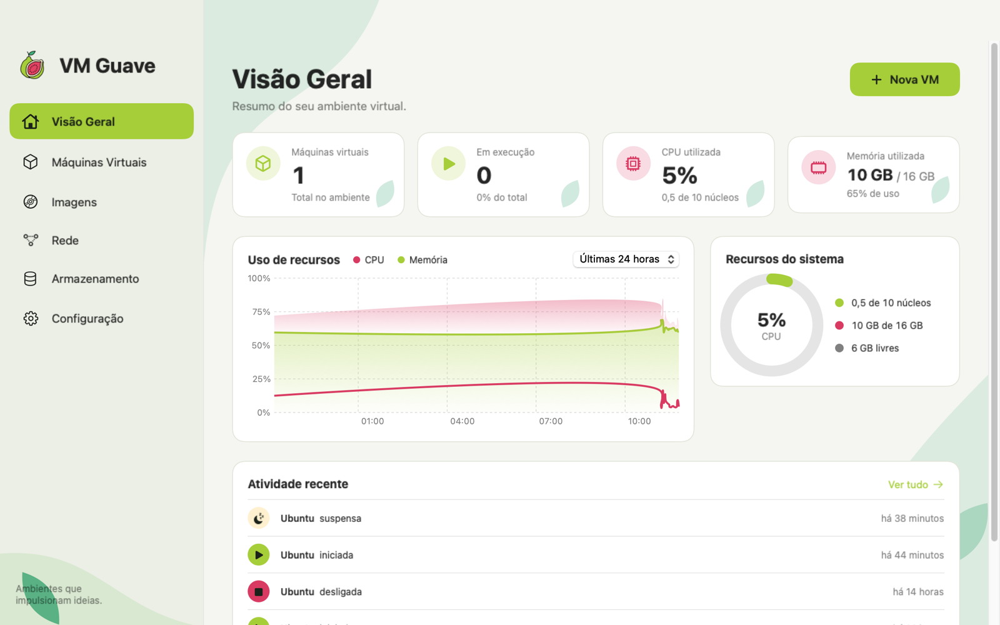

# VM Guave

Gerenciador de máquinas virtuais para macOS (Apple Silicon), construído do zero sobre o
`Virtualization.framework` da Apple, em Swift + SwiftUI.

Para **Windows e Linux** existe uma versão separada, em [`desktop/`](#windows-e-linux-desktop),
feita em Tauri (Rust + HTML) sobre o QEMU.

<picture>
  <source media="(prefers-color-scheme: dark)" srcset="site/assets/screenshots/app-overview-dark-1600.png">
  
</picture>

## Download

**Site: https://marloon-dev.github.io/vm-guave/**

Os instaladores ficam em **[Releases](https://github.com/marloon-dev/vm-guave/releases/latest)**:

| Sistema | Arquivo | Observação |
|---|---|---|
| macOS (Apple Silicon) | `VMGuave-<versão>.dmg` | Abra e arraste **VM Guave** para Aplicativos. Assinatura ad-hoc: na primeira vez, clique com o botão direito → **Abrir** |
| Windows 10/11 (x64) | `VM.Guave_<versão>_x64-setup.exe` | Instalador comum. O SmartScreen avisa: **Mais informações → Executar assim mesmo** |
| Windows (empresas) | `VM.Guave_<versão>_x64_pt-BR.msi` | Para instalação por política de grupo |
| Ubuntu / Debian | `VM.Guave_<versão>_amd64.deb` | `sudo apt install ./VM.Guave_*.deb` (já instala o QEMU) |
| Fedora / RHEL | `VM.Guave-<versão>-1.x86_64.rpm` | `sudo dnf install ./VM.Guave-*.rpm` (já instala o QEMU) |
| Qualquer Linux | `VM.Guave_<versão>_amd64.AppImage` | `chmod +x` e execute; instale o QEMU à parte |

No Windows e no Linux o VM Guave usa o QEMU, que precisa estar instalado — veja
[Windows e Linux](#windows-e-linux-desktop).

## Visual e atalhos

Desde a versão 0.2.0 o app do Mac usa a identidade da goiaba (verde da casca, rosa da polpa,
creme e verde-folha), nos modos claro e escuro:

- **Barra lateral** com o logo, o botão **Nova VM** e a lista de VMs com ícone do sistema e
  estado ao vivo (bolinha verde ligada, amarela pausada/suspensa).
- **Tela inicial ilustrada** quando ainda não há VMs, com o botão **Criar primeira VM**.
- **Detalhe da VM** com etiqueta colorida de estado e cartões de CPUs, memória, disco e snapshots.

| Atalho | O que faz |
|---|---|
| ⌘N | Nova VM |
| ⌘F | Entra e sai da tela cheia (também na janela da VM, com o teclado capturado) |
| ⌘, | Configuração |
| ⌘1 … ⌘6 | Seções da barra lateral |

Na tela cheia da VM, as barras de ferramentas e de menus se escondem e voltam quando o mouse
encosta no topo da tela (macOS 15 ou mais novo).

Dentro da VM, o ⌘F fica com o VM Guave e não chega ao sistema convidado (dá para desligar o atalho
em Configuração).

As cores e os componentes visuais (botão principal, etiqueta de estado, ilustrações) ficam em
`Sources/BootGuave/Views/Theme.swift`.

## Seções do app

A barra lateral tem seis seções (atalhos ⌘1 a ⌘6, menu **Ir**):

- **Visão Geral**: total de VMs, VMs ligadas, CPU e memória do Mac, gráfico de uso (última hora ou
  24 h, medido pelo app enquanto está aberto) e atividade recente (iniciar, desligar, criar,
  importar, snapshots…).
- **Máquinas Virtuais**: tabela com busca, filtro por estado e ações; clicar numa VM abre o detalhe.
- **Imagens**: distros do catálogo (download direto), Windows 11 ARM, macOS e as ISOs em Downloads
  ou importadas; "Usar imagem" abre o assistente com a imagem escolhida.
- **Rede**: a rede NAT padrão com diagrama, as redes próprias de cada VM e os IPs das máquinas.
- **Armazenamento**: espaço do disco, quanto ocupam VMs e imagens, discos de cada VM e
  "Criar volume" (disco adicional para uma VM desligada).
- **Configuração** (⌘,): idioma, tema (escuro por padrão), autoinício das VMs, o que fazer ao
  fechar com VMs ligadas, tela cheia, recursos padrão das novas VMs, atualizações e sobre. As
  mudanças valem ao clicar em **Salvar alterações**.

## Atualizações

O app procura versões novas na última Release do GitHub ao abrir, a cada 10 minutos e sempre que
volta para a frente. Quando encontra, mostra um alerta com as novidades e as opções **Atualizar
agora**, **Depois** e **Pular esta versão**. "Atualizar agora" baixa o `.dmg`, confere o SHA-256
publicado pelo GitHub, confere que o app de dentro é o VM Guave na versão anunciada e, ao reiniciar,
troca o app no lugar (o antigo só é apagado depois que a troca dá certo). Se o app não estiver numa
pasta em que o usuário possa gravar (por exemplo, aberto direto do `.dmg`), abre a página da versão.

Para publicar uma versão (os apps abertos oferecem a atualização em seguida):

```sh
./scripts/release.sh 0.3.0 "## Novidades
- Texto das novidades em Markdown"
```

O script muda a versão no `Info.plist`, faz o commit, gera o `.dmg`, cria a tag e a Release com o
`.dmg`. A tag dispara o GitHub Actions, que anexa os instaladores de Windows e Linux à mesma Release.

A interface está em português do Brasil e de Portugal, inglês, espanhol, francês, alemão, italiano,
japonês, chinês simplificado, coreano e russo. Por padrão segue o idioma do macOS; num sistema em
outro idioma, aparece em inglês. Para escolher um idioma só para o VM Guave, use Configuração → Geral.

O texto-fonte é o pt-BR escrito no código (`Text("...")`, `String(localized: "...")`); as
traduções ficam em `Resources/Localization/<idioma>.lproj/Localizable.strings`. Depois de mudar
textos, rode:

```sh
./scripts/strings.py check   # lista o que falta traduzir em cada idioma
```

## Requisitos

- Mac com Apple Silicon, macOS 14+
- Xcode instalado (as Command Line Tools sozinhas não trazem os plugins de macro do SwiftUI)

## Compilar e rodar

```bash
./scripts/build-app.sh          # release
./scripts/build-app.sh debug    # debug
open "build/VM Guave.app"
```

O script compila com SwiftPM, monta o `VM Guave.app` e assina ad-hoc com a entitlement
`com.apple.security.virtualization` (obrigatória para criar VMs).

## Instalador (.dmg)

```bash
./scripts/make-dmg.sh           # gera build/VMGuave-<versão>.dmg
```

Abra o DMG e arraste **VM Guave** para **Aplicativos**. A versão vem de
`CFBundleShortVersionString` no `Resources/Info.plist`.

Por padrão a assinatura é ad-hoc: funciona sem alerta só neste Mac. Para distribuir
para outras pessoas é preciso um certificado *Developer ID* (Apple Developer Program)
e notarização:

```bash
SIGN_IDENTITY="Developer ID Application: Seu Nome (TEAMID)" ./scripts/make-dmg.sh
xcrun notarytool submit build/VMGuave-0.1.0.dmg --keychain-profile <perfil> --wait
xcrun stapler staple build/VMGuave-0.1.0.dmg
```

## Windows e Linux (`desktop/`)

App multiplataforma em [Tauri 2](https://tauri.app) que cria e executa VMs com QEMU:
**KVM** no Linux, **WHPX** (Plataforma do Hipervisor) no Windows, com queda automática
para emulação se a aceleração não estiver disponível. O app do Mac continua sendo o Swift acima.

O que faz: criar VM Linux/Windows a partir de uma ISO (disco qcow2 que cresce conforme o
uso, NVMe, UEFI via OVMF), ligar/desligar/forçar, pausar/continuar, reiniciar, snapshots do
disco, redirecionar portas e aumentar o disco. A tela da VM abre numa janela própria do QEMU.
O estado vem do QEMU via QMP, então fechar e reabrir o app não perde o controle das VMs ligadas.

**O QEMU não vem junto** e precisa estar instalado:

- **Windows:** instalador de [qemu.org/download](https://www.qemu.org/download/#windows) na
  pasta padrão, e ativar *Plataforma do Hipervisor do Windows* em "Ativar ou desativar
  recursos do Windows" (sem isso as VMs ficam muito lentas).
- **Linux:** o `.deb`/`.rpm` já puxa `qemu-system-x86`, `qemu-utils`/`qemu-img` e o OVMF.
  Com o AppImage: `sudo apt install qemu-system-x86 qemu-utils ovmf`. Para usar o KVM:
  `sudo usermod -aG kvm $USER` e entrar de novo na sessão.

As VMs ficam em `%APPDATA%\VM Guave\VMs` (Windows) ou `~/.local/share/vm-guave/VMs` (Linux).

### Instaladores

São gerados pelo GitHub Actions (`.github/workflows/desktop.yml`), em máquinas Windows e Linux:

- **Aba Actions → "Instaladores Windows e Linux" → Run workflow**: os arquivos ficam nos
  *Artifacts* da execução (`.exe`, `.msi`, `.deb`, `.rpm`, `.AppImage`).
- **Tag de versão** (`git tag v0.1.0 && git push --tags`): além disso, cria um rascunho de
  *Release* com os instaladores anexados.

Os instaladores não são assinados: o Windows mostra o aviso do SmartScreen ("Mais
informações → Executar assim mesmo").

### Site

O site de lançamento fica em `site/` (HTML, CSS e JS puros) e é publicado no GitHub Pages
pelo workflow `.github/workflows/pages.yml` a cada alteração na `main`. Os botões de download
buscam os arquivos da última Release pela API do GitHub, então não é preciso editar o site a
cada versão. Para ver localmente: `python3 -m http.server -d site` e abrir http://localhost:8000.

### Desenvolver

```bash
cd desktop
npm install
npm run dev                     # abre o app (no Mac usa o QEMU do Homebrew com hvf)
cd src-tauri && cargo test      # testes; com VMGUAVE_TEST_ISO=<iso> e --ignored liga uma VM real
```

## VMs macOS

**+** → Sistema **macOS** → **Criar e instalar**. O VM Guave baixa da Apple a versão mais
recente compatível (~15 GB, em cache em `~/Library/Application Support/Boot Guave/IPSW/`) ou
usa um `.ipsw` que você escolher, e roda o instalador oficial (10–30 min). A pasta
compartilhada aparece sozinha no convidado em `/Volumes/My Shared Files`.

## Windows 11 ARM (motor QEMU)

O Virtualization.framework não tem drivers para Windows, então VMs Windows rodam no QEMU
com aceleração `hvf`, TPM 2.0 (`swtpm`) e disco NVMe. Pré-requisito:

```bash
brew install qemu swtpm
```

1. Baixe a ISO **Windows 11 ARM64** no site da Microsoft (o assistente tem o link).
2. **+** → Windows → escolha a ISO → **Baixar** drivers virtio-win → **Criar VM** → **Iniciar**.
3. A tela abre numa janela própria do QEMU. Aperte uma tecla em "Press any key to boot from CD".
4. Depois de instalar, a rede funciona após instalar o driver do CD virtio-win
   (`NetKVM\w11\ARM64`).

Limitações: sem suspender, sem pasta compartilhada e sem aceleração 3D (vídeo pelo `ramfb`).

## Rede

| Modo | Internet | IP | Redirecionar portas | Suspender |
|---|---|---|---|---|
| NAT (padrão) | sim | dinâmico (192.168.64.x) | não | sim |
| Compartilhada | sim | fixo (`.2` da sub-rede da VM) | sim | não* |
| Só com o Mac | não | fixo | — | não* |

\* O macOS não salva o estado de VMs em redes vmnet. Modos vmnet exigem macOS 26+.
VMs Windows usam o NAT do QEMU, com redirecionamento de portas.

## VM criptografada

**Mais → Criptografar…**: disco, snapshots e estado vão para uma imagem APFS com AES-256
(`vault.sparsebundle`). Desbloquear monta a imagem; bloquear (ou fechar o app) desmonta.
A senha pode ficar no Keychain. Sem a senha, a VM é irrecuperável.

## Importar discos de outros programas

**Importar → Disco de outro programa**: qcow2, vmdk, vdi, vhdx, raw (UTM, VirtualBox,
VMware…). O sistema dentro do disco precisa ser **ARM64**. Usa o `qemu-img`.

## Linha de comando (`bgctl`)

O `bgctl` vem dentro do app. Para usar de qualquer lugar:

```bash
sudo ln -sf "/Applications/VM Guave.app/Contents/MacOS/bgctl" /usr/local/bin/bgctl
```

```bash
bgctl list
bgctl start Fedora
bgctl snapshot create Fedora "antes da atualização"
bgctl suspend Fedora
bgctl export Fedora /Volumes/Backup
bgctl encrypt Fedora            # pede a senha sem eco
bgctl unlock Fedora
bgctl help
```

Ele fala com o app por um socket Unix (`~/Library/Application Support/Boot Guave/control.sock`,
só o seu usuário acessa). Se o app estiver fechado, o `bgctl` abre em segundo plano.

## Estrutura

```
Sources/
├── ControlProtocol/                  # JSON do socket, compartilhado app ↔ bgctl
├── bgctl/main.swift                  # CLI
└── BootGuave/
    ├── BootGuaveApp.swift            # janelas + AppDelegate (sair suspendendo, abrir .bootguave)
    ├── Control/                      # servidor do socket, comandos do bgctl, cópia única do app
    ├── Settings/                     # ajustes guardados (padrões, tema, idioma)
    ├── Monitoring/                   # CPU/memória do Mac, atividade recente, atualizações
    ├── Download/                     # ISOs/IPSW com progresso; catálogo de distros
    ├── Network/                      # vmnet: redes próprias, IP fixo, portas
    ├── QEMU/                         # motor do Windows (QEMU + swtpm + QMP)
    ├── Models/VMConfig.swift         # configuração persistida da VM
    ├── Storage/
    │   ├── VMBundle.swift            # pacote em disco (.bootguave), NVRAM, cópia esparsa
    │   ├── VMSnapshots.swift         # snapshots via clone APFS
    │   ├── VMVault.swift             # criptografia (sparsebundle AES-256) + Keychain
    │   ├── DiskImporter.swift        # qcow2/vmdk/vdi/vhdx → raw/qcow2
    │   └── VMLibrary.swift           # lista de VMs, clonar, exportar/importar
    ├── VM/
    │   ├── VMConfigurationBuilder.swift  # VMConfig → VZVirtualMachineConfiguration (Linux e macOS)
    │   └── VMRunner.swift            # ciclo de vida, suspender, instalação do macOS
    └── Views/                        # SwiftUI (Theme.swift: cores e ilustrações)
        ├── Design/Components.swift   # cartões, cabeçalhos, tabelas, filtros
        ├── Shell/AppRouter.swift     # seções da barra lateral e navegação
        └── Pages/                    # Visão Geral, Máquinas, Imagens, Rede, Armazenamento, Configuração
Resources/Localization/               # traduções (<idioma>.lproj/Localizable.strings)
```

As VMs ficam em `~/Library/Application Support/Boot Guave/VMs/<uuid>.bootguave/`:
`config.json`, `disk.img` (esparso), `disks/`, `efi-vars.fd` ou `aux.img` + `hardware-model` (macOS),
`machine-id`, `state.vzvmsave` (se suspensa) e `snapshots/`.

## Usando uma VM Linux

1. Baixe uma ISO **ARM64**, ex.: Ubuntu Desktop for ARM.
2. No VM Guave: **+** → nome, ISO, CPU/RAM/disco → **Criar VM** → **Iniciar**.
3. Instale o sistema normalmente. Ao terminar, desligue e clique em **Ejetar ISO**.
4. No Linux convidado:
   - Área de transferência: `sudo apt install spice-vdagent`
   - Pasta compartilhada: `sudo mount -t virtiofs bootguave /mnt`

## Rosetta (programas x86_64 no Linux)

Ative em **Configurações… → Rosetta**. No Linux convidado:

```bash
sudo mkdir -p /media/rosetta
sudo mount -t virtiofs rosetta /media/rosetta
sudo /usr/sbin/update-binfmts --install rosetta /media/rosetta/rosetta \
  --magic "\x7fELF\x02\x01\x01\x00\x00\x00\x00\x00\x00\x00\x00\x00\x02\x00\x3e\x00" \
  --mask "\xff\xff\xff\xff\xff\xfe\xfe\x00\xff\xff\xff\xff\xff\xff\xff\xff\xfe\xff\xff\xff" \
  --credentials yes --preserve no --fix-binary yes
```

No Fedora, use `systemd-binfmt` com um arquivo em `/etc/binfmt.d/rosetta.conf` em vez de `update-binfmts`.

## Roadmap

Comparado com o que um virtualizador comercial completo oferece, separado pelo que o
`Virtualization.framework` permite.

**Fase 1 — feito**
- [x] Lista de VMs, assistente Linux, tela, NAT, pasta compartilhada, áudio, clipboard
- [x] Snapshots (clone APFS; com a VM suspensa incluem a memória)
- [x] Suspender/retomar (salva memória em disco), reiniciar, pausar, desligar, forçar
- [x] Clonar VM, editar configurações (CPU, RAM, aumentar disco)
- [x] Isolamento da área de transferência, Rosetta para Linux
- [x] Modo janela, tela cheia, Picture in Picture

**Fase 2 — feito**
- [x] VMs macOS (download de IPSW + instalação)
- [x] CLI `bgctl` (list/start/stop/suspend/snapshot/clone/export/import)
- [x] Discos adicionais, redefinir NVRAM (ordem de boot), iniciar VM ao abrir o app
- [x] Exportar/importar VM (.bootguave), backup para disco externo
- [x] Downloads guiados de distros (Ubuntu, Fedora, Debian ARM)
- [x] Arrastar arquivos do Finder para a VM (via pasta compartilhada)
- [x] Ao sair do app com VMs ligadas, oferece suspender

**Fase 3 — feito**
- [x] Rede só com o Mac, rede compartilhada com IP fixo e redirecionamento de portas (vmnet)
- [x] VM criptografada (sparsebundle APFS AES-256, senha opcional no Keychain)
- [x] Importar discos qcow2/vmdk/vdi/vhdx (conversão com qemu-img)
- [x] Windows 11 ARM no motor QEMU (hvf + TPM 2.0 + NVMe), com controle via QMP

**Versão 0.2.0 — feito**
- [x] Novo visual com a identidade da goiaba (barra lateral, tela inicial ilustrada, detalhe da VM)
- [x] Tela cheia por ⌘F

**Fase 4 — possível**
- [ ] Impedir duas cópias do app abertas ao mesmo tempo (hoje a segunda apaga o socket do `bgctl`)
- [ ] USB do Mac na VM: a API existe no macOS 27 (`VZUSBPassthroughDevice`), mas exige a
      entitlement `com.apple.developer.accessory-access.usb` (Apple Developer Program)
- [ ] Suspender VMs Windows (`savevm` do QEMU, disco qcow2)
- [ ] Tela do Windows dentro da janela do VM Guave (QEMU via VNC/SPICE embutido)
- [ ] Várias VMs na mesma rede vmnet (laboratório com várias máquinas)

**Limitações do framework da Apple (fora de alcance)**
- Rede bridge: exige entitlement restrita da Apple (`com.apple.vm.networking`)
- Bluetooth e webcam físicos do Mac na VM
- Coherence (apps do convidado soltos no desktop do Mac) e aceleração 3D/DirectX
- Toolbox de utilitários, gestão empresarial (SSO, SCIM, Jamf): produtos à parte

## Marcas

Os logotipos da página Imagens (Ubuntu, Debian, Fedora, Windows e Apple) vêm do
[Simple Icons](https://simpleicons.org) e ficam em `Resources/Logos/`. Servem só para identificar
cada sistema; as marcas pertencem aos donos, e o VM Guave não é afiliado a eles.

## Licença

[MIT](LICENSE) © 2026 Marlon Nunes Vieira
